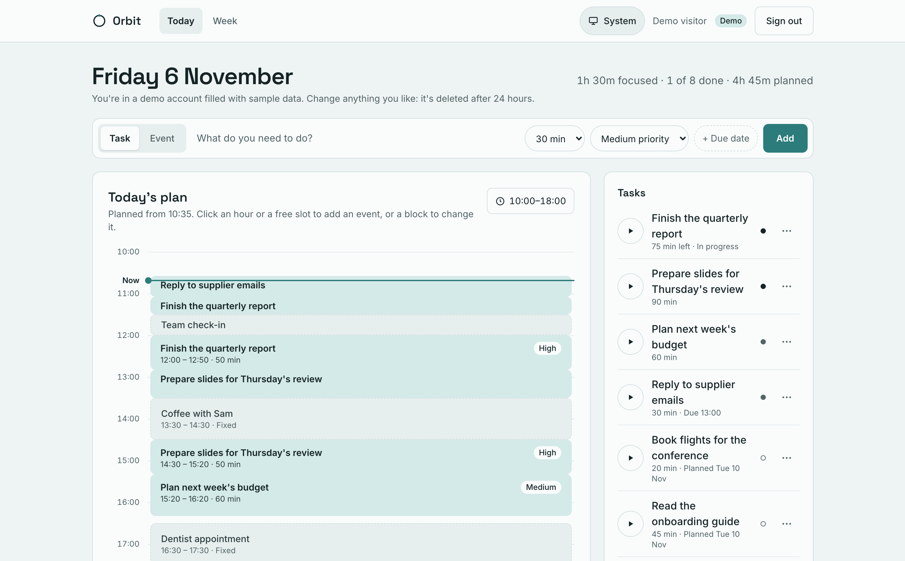
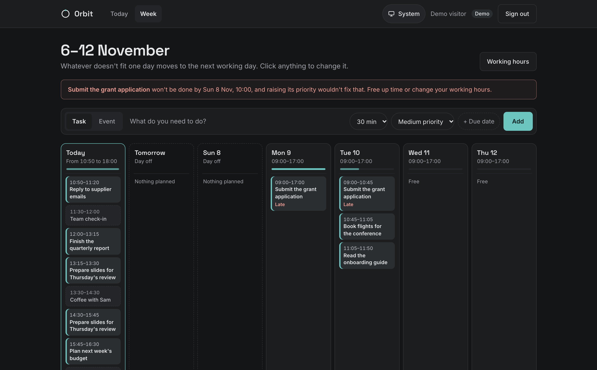

# Orbit

[](https://github.com/MariusMalong/orbit/actions/workflows/ci.yml)

Orbit is a daily planner that builds your schedule for you. You give it tasks (with a time estimate and a priority), the events you can't move, and the hours you want to work. It fits the tasks into the gaps and redraws the plan whenever something changes.

**Try it: [use-orbitplanner.vercel.app](https://use-orbitplanner.vercel.app)**

Click **Try the demo** to get your own temporary account, filled with a day of sample tasks and commitments. There's no sign-up, and the account is deleted after 24 hours. Try starting a focus timer, moving a commitment or changing your hours, and watch the plan redraw. You can also sign in with GitHub or Google (Orbit only reads your name, profile picture and email address).





I'm building it to learn how to design a scheduling algorithm properly and to practise full-stack patterns in a real multi-user app. It's a work in progress.

## How the scheduler works

The core is a single pure function, `generateSchedule` in [`src/lib/engine/scheduler.ts`](src/lib/engine/scheduler.ts). It knows nothing about the database. It takes plain task and time-window objects and returns a list of blocks, which makes it easy to reason about and test on its own.

For each day it:

1. Starts from your working hours (for example 09:00–17:00). Once the day has started, it plans from the current time instead, rounded up to the next 5 minutes, because time that has passed can't be planned.
2. Cuts out your fixed commitments, leaving a list of free windows.
3. Orders the tasks in two tiers. Tasks due today (including overdue ones) go first, earliest deadline first. Within one day that's the "earliest deadline first" rule, which keeps lateness as low as possible when work can be split. Everything else follows priority, with the deadline only breaking ties.
4. Walks through the free windows, placing each task in the earliest space available. A task that doesn't fit in one window is split across the next ones, but never into a block shorter than 15 minutes: a gap too small to be useful is left empty, and a split is shortened if it would leave a sliver behind.
5. Marks any task that still has time left over at the end of the day as "bumped", and any task that won't be finished by its deadline as "late", so the UI can warn you.

That's one day. `generateMultiDaySchedule` ([`src/lib/engine/multi-day.ts`](src/lib/engine/multi-day.ts)) runs it over the next 7 days, each with its own working hours, and whatever doesn't fit one day carries over to the next.

On its own, rolling forward like that would leave a big task due on Wednesday until Wednesday. So each day starts by planning backwards from the deadlines ([`src/lib/engine/reservations.ts`](src/lib/engine/reservations.ts)):

1. For each task with a deadline, work out how much of it **must** happen today: whatever won't fit into the free working time between tomorrow and its deadline.
2. Take the tasks earliest deadline first, and count each one together with everything due before it, so two tasks can't both rely on the same spare hours later in the week. This is the standard feasibility check for earliest-deadline-first scheduling, applied one day at a time.
3. Plan those must-do pieces first, then fill the rest of the day by priority as usual.

Work is only pulled forward when it's really needed, so when there's room later, your priorities decide. The Week page compares the plan with one made by priority alone ([`src/lib/engine/changes.ts`](src/lib/engine/changes.ts)) and says what started early for a deadline and what moved later to make room. Deadlines are then checked against when each task actually finishes, so a task that can't make it even when started as early as possible is flagged straight away.

You can also place a task yourself, by dragging it on the timeline or the Week board, or by giving it a start time. Placed tasks are planned first, at their time, around your events, and from then on everything else treats them like an event. A placed task that runs past the end of its day continues on the next working day. When its time has passed, or you choose "Let Orbit plan it", it goes back to being planned automatically.

The plan isn't stored. It's recalculated on every page load from the current data, so editing a task, adding a meeting or logging time changes it immediately.

## What works today

- Sign in with GitHub or Google, or try a demo account with sample data. A new account starts with a short setup: your working hours and days off, and a few first tasks.
- Add tasks and fixed commitments (events, such as appointments or lectures) from one quick-add bar at the top of the page. Each task has a title, a time estimate, a priority (low, medium or high) and an optional due date and time.
- Click an upcoming hour or a free slot on the timeline to add an event there, and click any block to edit it, mark it as done or delete it.
- Drag a task up or down the timeline to a new time, or to another day on the Week page, and the rest of the plan moves around it. With a keyboard or on a touch screen, set a start time in the task's edit dialog instead.
- Group tasks into projects, each with its own colour. A project's tasks are marked in that colour on the plan, the task list can be filtered by project, and the Week page shows how much time each project gets this week.
- Make an event repeat every week, such as a lecture or a gym session. Edit or delete just one week of it, or every week at once.
- Set your working hours for the whole week in one place, and mark days off: nothing gets planned on them, and work moves to the next working day.
- See whatever doesn't fit today planned into the following days, next to your upcoming events, under "Coming up", and how full each day of the week is.
- See the next 7 days side by side on the Week page, with how full each day is. Tasks with deadlines are started as early as they need to be, and the page says what started early and what moved later to make room.
- See today's plan on an hour-by-hour timeline, with commitments shown alongside the scheduled tasks, a line marking the current time, and warnings for anything that doesn't fit or won't make its deadline.
- On a phone, see what to do now at the top of the page, with a large Start focus button and the next few things after it.
- Use a focus timer on any task from the task list. Stopping it logs the time worked, takes it off the task's remaining estimate (completing the task when it reaches zero), and redraws the plan.
- A summary of the day: time focused, tasks completed versus planned, and time still scheduled.
- Delete your account, and everything in it, from the Account page (click your name in the header). The [privacy policy](https://use-orbitplanner.vercel.app/privacy) lists everything Orbit stores.
- Light and dark themes. By default Orbit follows your device's setting; the switch in the header can fix it to light or dark, and the choice is remembered.

## Design decisions

- **The engine is decoupled from the database.** Pages read from Prisma, convert the rows into small engine types (`SchedulableTask`, `TimeWindow`), and pass those in. The analytics summary (`src/lib/analytics/summarize.ts`) follows the same pattern.
- **Every query is scoped to the signed-in user.** Server Actions take the user ID from the server-side session, never from the request, and filter every read and write by it. `TimeEntry` has no user column, so it's checked through its parent task, both when an entry is created and when entries are read.
- **Weekly events are stored once and expanded when planning.** A weekly event keeps its first occurrence plus a list of weeks skipped or moved on their own, so editing one week never rewrites the others. Weeks are counted in the visitor's timezone, so a 09:00 lecture stays at 09:00 across daylight-saving changes (`src/lib/planning/recurrence.ts`).
- **Times are stored as instants and planned in the visitor's timezone.** The server runs in UTC, so "today", "09:00" and "Friday" are worked out in the visitor's own timezone by small `Intl`-based helpers (`src/lib/time/zoned.ts`), which are tested across Melbourne's daylight-saving changes. The browser saves its timezone in a cookie. Until it has, Vercel's IP-based guess is used.
- **Time is stored in whole minutes.** Durations are integers, which avoids floating-point drift when times are added up and subtracted.
- **Demo accounts are ordinary users.** "Try the demo" creates a user flagged `isDemo`, fills it from a pure seed function, and creates an Auth.js database session for it. Each visitor gets their own account, and everything else (including the per-user scoping) works exactly as for a signed-in user. Demo accounts older than 24 hours are deleted the next time someone starts a demo.
- **Colours are role tokens.** Components use utilities such as `bg-surface` and `text-muted`, which read CSS variables defined in `globals.css`. Dark mode only swaps those variables, so no component needs `dark:` classes. The chosen theme is kept in a cookie, so the server renders the right one straight away, without a flash of the wrong colours.
- **Demo accounts are rate-limited without storing IP addresses.** Each demo records a keyed hash of the visitor's IP (HMAC with the app's secret), so one visitor can start 10 an hour and everyone together 300. Requests from the machine itself, as in local development and CI, only count towards the overall limit.
- **Buttons are named by what they show.** A button with visible text has no separate `aria-label`: its text is its name, so voice-control users can say what they see. Anything a screen reader needs beyond that, like the time of a block too short to show it, sits in a visually hidden span inside the button. Icon-only buttons, like the ⋯ menu, have a label.
- **No experimental React features.** I've left the React Compiler and Cache Components switched off, so state and memoization are handled by hand.

## Known limitations

- Deadlines are planned for within the 7-day window. A task due further out is planned by priority until its deadline comes into the window.
- Until you change them, every day is a 09:00–17:00 workday, weekends included.
- Tasks with the same priority (and no deadline today) are planned in the order they were added, newest first, not by length.

## Next steps

- Plan for deadlines beyond the 7-day window.
- Drag tasks on touch screens, with a long press.
- Saved schedules. The `Schedule` and `ScheduleBlock` models are already in the schema but aren't used yet.

## Tech stack

- Next.js 16 (App Router, Server Components, Server Actions) with TypeScript
- PostgreSQL: [Neon](https://neon.com) in production, Docker locally
- Prisma 6, with migrations
- Auth.js v5 with GitHub and Google OAuth
- Tailwind CSS v4
- Vitest for the engine and analytics tests
- Hosted on Vercel, with CI on GitHub Actions

## Deployment

The live site runs on Vercel and deploys every push to `main`. The build runs `prisma migrate deploy` before `next build`, so schema changes go out with the code that needs them. The database is a Neon Postgres instance in Sydney. The app connects through Neon's connection pooler, and migrations use the direct connection (`DIRECT_URL`).

Pull requests get their own Vercel preview URL, and `main` is protected: a pull request can only be merged once CI passes.

## Project layout

```
prisma/schema.prisma        Database schema
prisma/migrations/          SQL migrations, applied on deploy
src/app/page.tsx            Today: the timeline, task list and week overview
src/app/week/page.tsx       Week: the next 7 days side by side
src/app/actions/            Server Actions for tasks, commitments, availability and time entries
src/lib/engine/             The scheduling engine (one day, and 7 days)
src/lib/planning/           Loads a user's data and plans their week; working hours, day load
src/lib/analytics/          Daily summary calculations
src/lib/demo/               Sample data for demo accounts
src/components/             UI components
```

## Running it locally

You'll need Node.js 24 (see `.nvmrc`) and Docker.

1. Clone the repo and install dependencies:

   ```bash
   git clone https://github.com/MariusMalong/orbit.git
   cd orbit
   npm install
   ```

2. Start a PostgreSQL container:

   ```bash
   docker run --name orbit-db -e POSTGRES_USER=postgres -e POSTGRES_PASSWORD=password -e POSTGRES_DB=orbit -p 5432:5432 -d postgres:15-alpine
   ```

3. Create a GitHub OAuth app under **GitHub → Settings → Developer settings → OAuth Apps**. Set the homepage URL to `http://localhost:3000` and the callback URL to `http://localhost:3000/api/auth/callback/github`.

   Google sign-in is optional. To turn it on, create an OAuth client ID (type "Web application") in the [Google Cloud console](https://console.cloud.google.com/apis/credentials) with the redirect URI `http://localhost:3000/api/auth/callback/google`, and set `AUTH_GOOGLE_ID` and `AUTH_GOOGLE_SECRET`.

4. Copy the example environment file, then fill in `AUTH_SECRET` and your OAuth app's client ID and secret:

   ```bash
   cp .env.example .env
   ```

5. Create the database tables:

   ```bash
   npx prisma migrate dev
   ```

6. Start the dev server and open http://localhost:3000:

   ```bash
   npm run dev
   ```

## Checks

```bash
npm run typecheck     # TypeScript
npm run lint          # ESLint
npm run format:check  # Prettier (npm run format to fix)
npm test              # Vitest
npm run test:e2e      # Playwright (needs the database running)
```

The end-to-end tests in `e2e/` drive the real app in Chromium against a real database. Each test starts its own demo account and covers a flow people actually use: adding and finishing tasks, the focus timer, weekly events (adding, moving every week, deleting one week), working hours and days off, the theme switch, and the phone's Now card. `e2e/accessibility.spec.ts` also runs axe on every page and dialog in light and dark mode, and fails on any WCAG 2.1 AA violation, such as low contrast, missing labels, or a button whose accessible name doesn't match its visible text. The browser's timezone is chosen so it's always mid-morning there, so the demo has a full day planned whenever the tests run. The first time, install the browser with `npx playwright install chromium`. The tests start their own dev server; if `npm run dev` is already running, Next.js won't start a second one, so point the tests at yours instead: `E2E_BASE_URL=http://localhost:3000 npm run test:e2e`.

GitHub Actions runs all of these on every push to `main` and every pull request: the checks and a production build in one job, and the end-to-end tests against a Postgres service in another.
